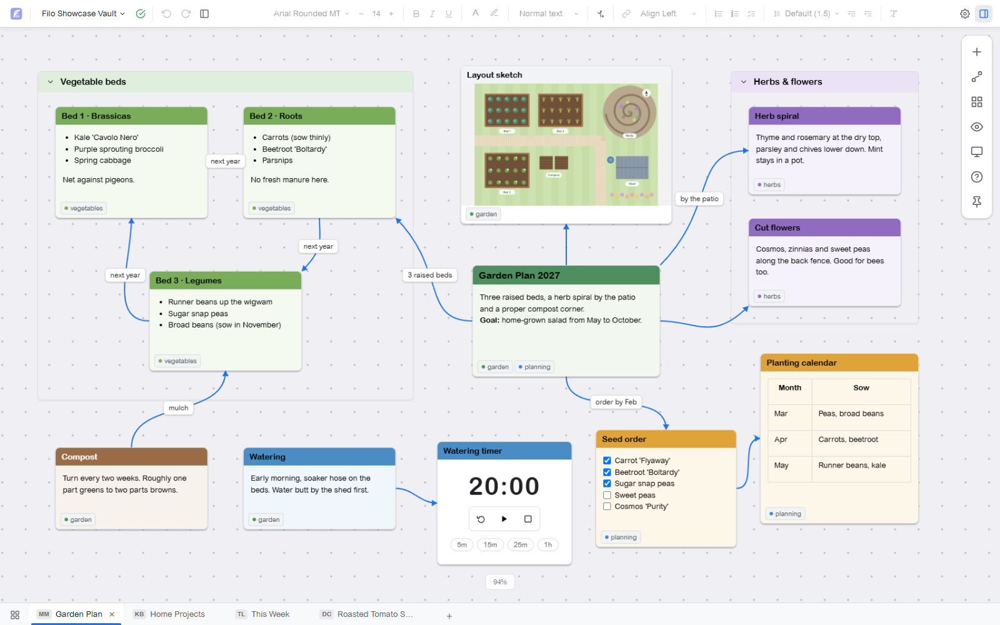
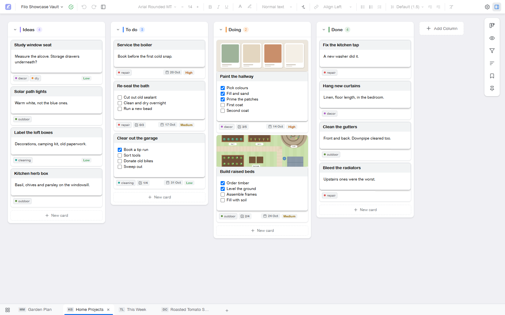
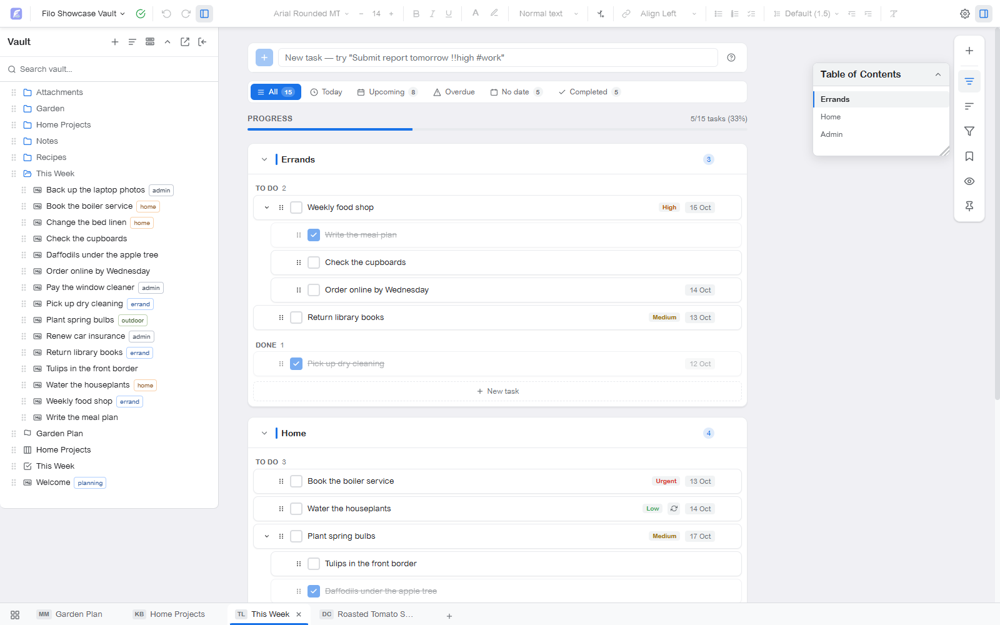
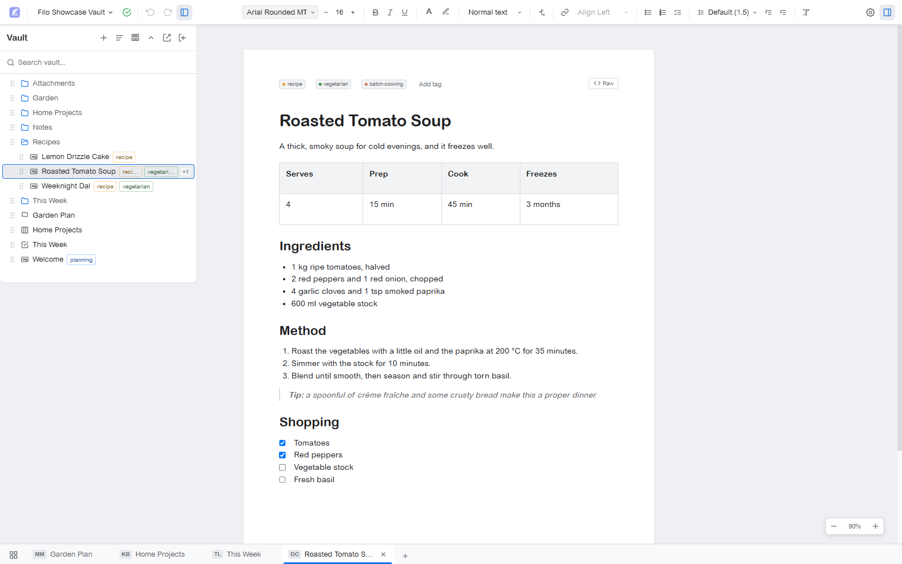
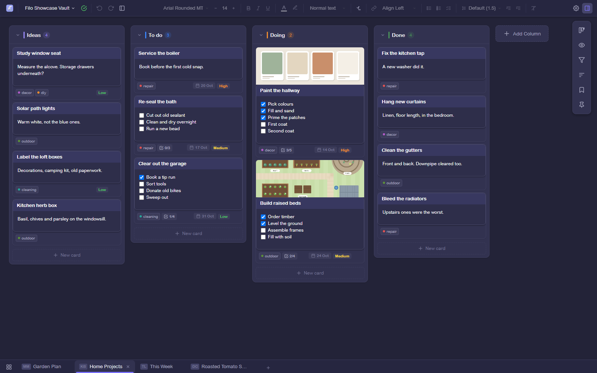

# Filo

A local-first desktop app for visual note-taking: mind maps, Kanban boards, task lists and documents in one place. Your notes are plain Markdown files in a folder you choose. No account, no cloud, no lock-in.



<p align="center">
  
  
  
  
</p>

## Features

- **Four kinds of board.** A **Mind Map** is an infinite canvas with connections, frames, smart guides and a minimap. A **Kanban** board has columns of cards with tags, due dates and priorities. A **Task List** has sections, subtasks, grouping and quick add that understands "tomorrow" or "next fri". A **Document** gives a note a paged writing view with the full formatting toolbar.
- **One note, many boards.** Every text tile, card and task is a `.md` file. Put the same note on several boards and an edit anywhere shows everywhere.
- **Tiles for everything.** Text, images, video, audio (including recording), files, links, embeds and timers. Drag a file in from Explorer and Filo picks the right tile.
- **Find anything.** Tags live in each note's frontmatter, with a Tags Browser to manage them. Vault-wide search supports `tag:`, `board:`, `type:` and `/regex/`, with Replace All.
- **Work your way.** Split panes, board and layout templates, per-board undo, five themes plus your own, and shortcuts you can rebind (**Help → Shortcuts**).
- **Plays well with sync.** Keep a vault in OneDrive or Dropbox, or carry it on a USB stick. Filo notices edits made by other apps, recognises sync-conflict copies, and keeps a trash and recovery copies inside the vault.

## Your files

A vault is just a folder. Notes are Markdown with YAML frontmatter, boards are `.board.json` files, and media stays in its own format. Filo keeps its settings in a hidden `.filo/` folder and never touches anything outside the vault. Open the folder in any text editor and it all still makes sense.

## Install

Download `Filo-Setup-<version>.exe` from the [latest release](https://github.com/totallynotkasai/filo/releases/latest) and run it. The installer isn't code-signed, so Windows SmartScreen may warn you: choose **More info → Run anyway**.

Then click **Open Vault**, pick any folder, and add a board from the tab bar's **+**.

macOS and Linux builds aren't published; build them from source as below.

## Build from source

Requires Node.js 22.

```bash
git clone https://github.com/totallynotkasai/filo.git
cd filo
npm install
npm run dev:scratch    # development, with hot reload, on a separate scratch profile
npm run build          # production build to dist/
npm run package:win    # Windows installer in release/ (package:mac, package:linux for the others)
```

Tests: `npm run test:unit` (unit, component and Chromium tests), `npm run test:e2e` (drives the built app; run `npm run build` first), and `npm run ci:verify` for everything CI checks.

## Built with

Electron, Svelte 5 and TypeScript on Vite. TipTap for rich text with a Markdown round-trip, CodeMirror 6 for a note's Raw view, an in-memory search index, and a custom pointer-event canvas with an rbush spatial index. Plain CSS throughout.

[`Filo_Design_Doc_Rework_V5.md`](Filo_Design_Doc_Rework_V5.md) is the full specification, [`KNOWN_LIMITATIONS.md`](KNOWN_LIMITATIONS.md) lists the deliberate trade-offs, and [`CLAUDE.md`](CLAUDE.md) covers the architecture and conventions.

## Licence

[MIT](LICENSE)
